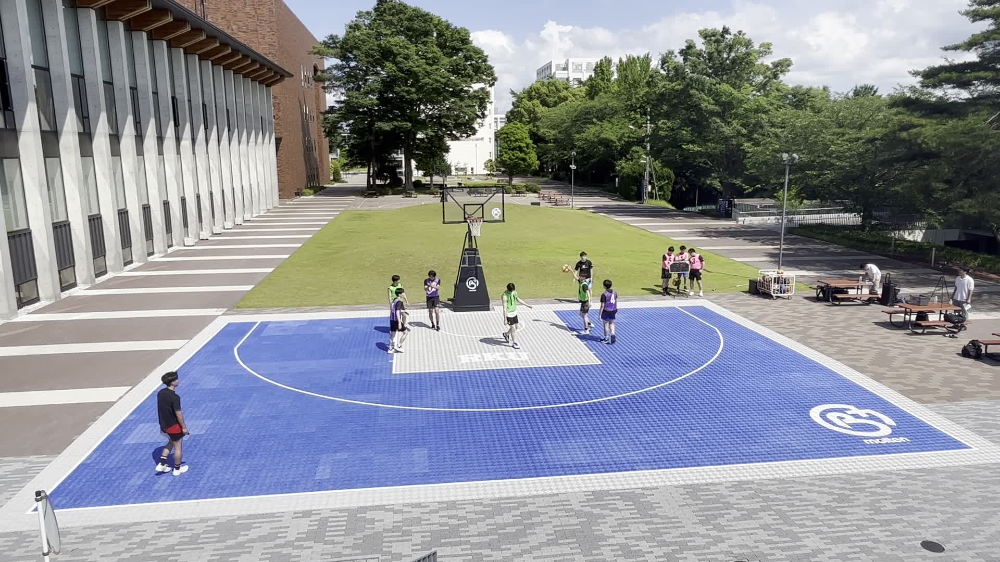
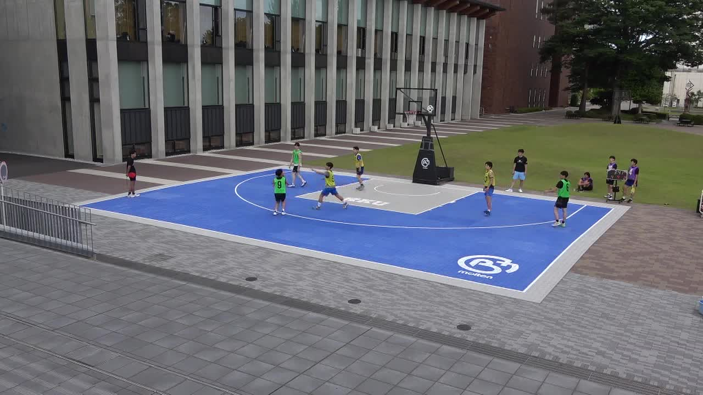
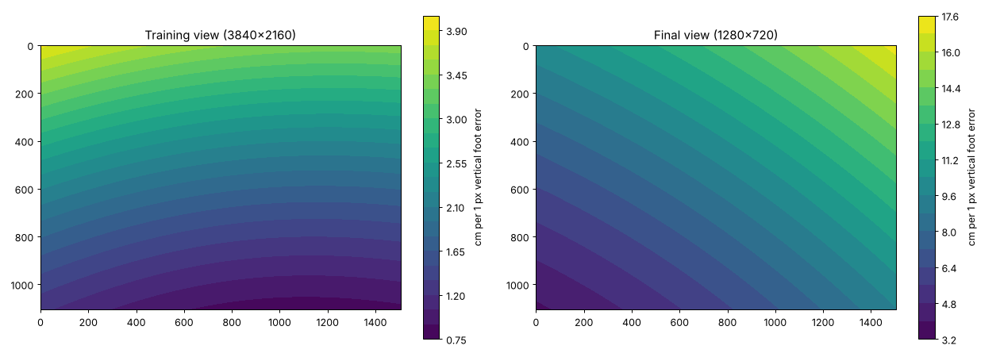
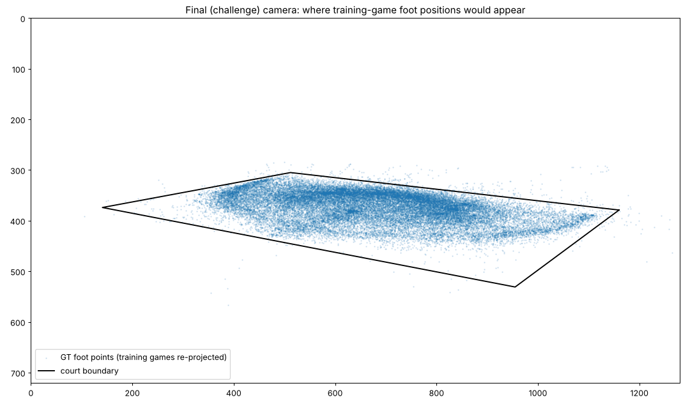
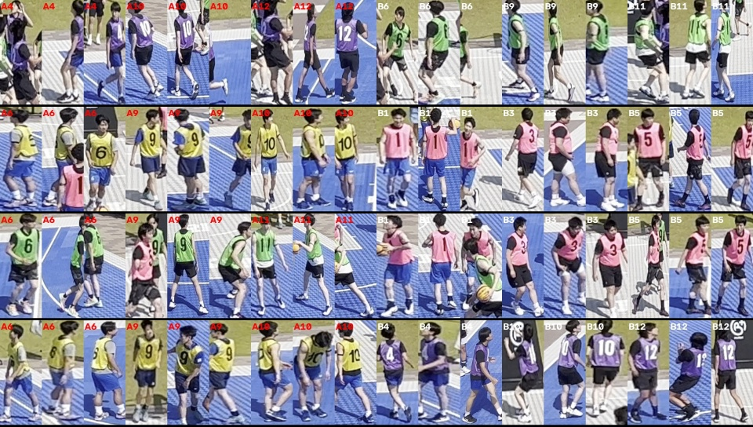
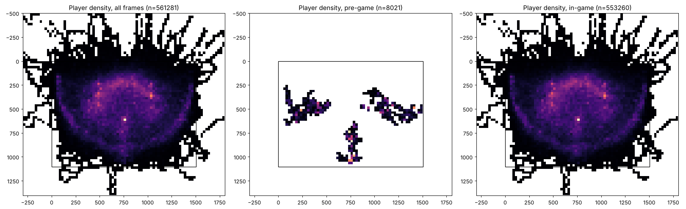
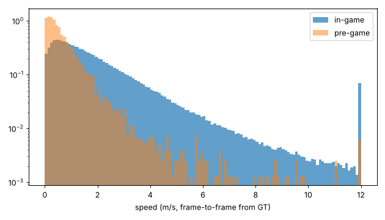
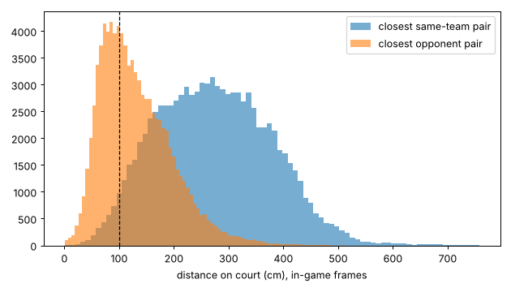
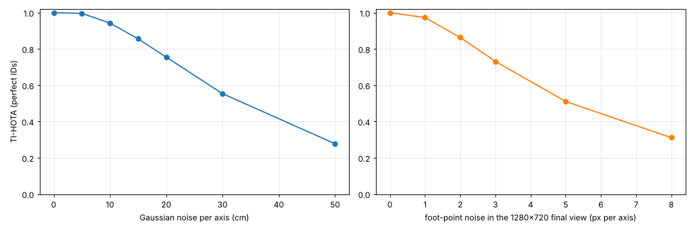

# TrackID3x3 Training data: patterns and what they mean for the method

Reproduce with:

```
python analysis/analyze_training.py <DATA_DIR> analysis
```

The script writes `results.json` and the figures in `figures/`. Only the official
Training set (IMG_0104–0111) and the two registration/roster files are used. Bib colours
were measured on 4K frames of IMG_0104–0107. (Drive rate-limited the other video downloads.)

## 0. Two views at a glance

| Training camera (IMG_0104, 4K) | Final camera (IMG_0114, 720p) |
|---|---|
|  |  |

Camera parameters were recovered from the 4-corner homography, assuming square pixels and a
centred principal point. The model is validated: it predicts a median player height of
**177 cm** (IQR 171–183) from the annotated training boxes.

| | Training | Final |
|---|---|---|
| Camera position (court cm) | (948, 2163), 5.2 m high | (−469, 2212), 4.3 m high (off to the side) |
| Distance to court centre | 17 m | 21 m |
| Depression angle | 17.7° | **11.8°** (flatter) |
| Focal length | 2652 px @ 3840 | 1266 px @ 1280 |
| Player height in image | ~272 px (217–367) | **~87 px (75–105)** (simulated) |
| cm per 1 px foot error, at players | 2.2 cm (p90 2.9) | **9.8 cm (p90 12.5)** |

Court coordinates: `x` runs 0–1505 along the baseline, and `y = 0` is the baseline under
the hoop. The density hot-spot at (750, 600) is the free-throw spot. Both cameras look from
the `y > 1105` side.




In the final view the whole playing area occupies only about **x 300–1150, y 300–450 px**.
The busiest region (near the hoop) is also the far, worst-resolved part of the image.

## 1. Ground-truth construction (exact)

- **GT court position = training-camera homography applied to bbox bottom-centre**
  `(x + w/2, y + h)`. Max error is 0.001 cm on **all 8 videos**. One homography (the
  `court_registration.csv` corners) is shared by all training videos.
- The challenge GT comes from the top-view annotations of the same games. It is therefore
  "bottom-centre of a box seen from the *training* camera", not from the camera we are
  given.

### GT noise is along the training camera's viewing ray

Deviation of the GT from a 9-frame median:

| video | rows > 30 cm off | median radial | median tangential | small-noise std |
|---|---|---|---|---|
| 0104–0109 | 0.23–0.36 % | 38–41 cm | 2–4 cm | ~1.0 cm |
| **0110, 0111** | **1.4–1.7 %** | 39–42 cm | 3 cm | **1.9 cm** |

- Outliers are almost purely **radial** with respect to the training camera (≈60 %
  pointing away). They come from the bbox bottom moving vertically, such as jumps, raised
  feet, or loose box bottoms, and the ground plane turns that into depth error.
- A tracker that is perfect but smooth still scores **0.998 / 0.995 / 0.989** TI-HOTA
  (median filters of 5 / 9 / 15 frames). **Temporal smoothing costs almost nothing**,
  even against these spikes.
- IMG_0110 and IMG_0111 have the noisiest labels. Down-weight them, or clean them, when
  training a foot-point regressor.

## 2. Identities and teams: the strongest pattern

There are only **4 teams (12 people)**, and each team wears **one bib colour in every
video**:

| Team (jerseys) | Bib | Training videos | Final |
|---|---|---|---|
| {4, 10, 12} | **purple** (hue ≈ 128) | 0104, 0107, 0109, 0110 | IMG_0115 → **A** |
| {6, 9, 11} | **green** (hue ≈ 50) | 0104, 0106, 0108, 0110 | IMG_0114 → **B** |
| {6, 9, 10} | **yellow** (hue ≈ 28) | 0105, 0107, 0108, 0111 | IMG_0114 → **A** |
| {1, 3, 5} | **pink** (hue ≈ 167) | 0105, 0106, 0109, 0111 | IMG_0115 → **B** |



Consequences:

- **Team = bib colour.** A/B in the final videos follows from the roster plus the colour
  (IMG_0114: yellow = A, green = B; IMG_0115: purple = A, pink = B). The "A = initial
  offense" rule agrees with this but is no longer needed. *Rule note (organiser email):*
  manual identity assignment is prohibited. The colour → team-group classifier must be
  trained on the Training set and applied automatically. The A/B naming then comes from
  the official roster. Do not hard-code it per Challenge video.
- **The same 12 people play every game.** Each person appears in 4 training videos (about
  45k labelled frames each). A **12-class person classifier / ReID**, trained only on
  the Training set, is allowed and can identify players where jersey OCR is impossible.
  At ~87 px player height in 720p, the digits are only a few pixels tall.
- The two #6 players and the two #9 players in IMG_0114 differ by bib colour (and by
  person), so colour plus ReID separates them.
- **Distractors:** people outside the court wear bibs too. Waiting teams wear the
  non-playing colours (purple was waiting in IMG_0114). A detection whose bib colour is
  not one of the two roster colours is not a player.

## 3. Data-quality quirks

| Video | Quirk |
|---|---|
| IMG_0104 | 80 frames with only 5 players (A10 and B6 missing in places) |
| IMG_0105 | 25 frames with **7 rows** (duplicate A9 / A6 identity) |
| IMG_0106 | 149 frames with 5 players |
| IMG_0110 | 1 extra bbox row (64 237 vs 64 236). Bbox `track_id`s are not stable identities. |
| IMG_0111 | 1 frame with 5 players |

- The bbox `track_id` column is not a reliable identity (heavily swapped in 0110/0111).
  Use the court file's `(team, jersey)` for identity, and join the two files per frame by
  projection, not by row order.
- The GT ends a few frames before the video (IMG_0104: 11 376 GT frames vs 11 400 video frames).

## 4. Where players are



- **1.2 %** of rows are outside the court rectangle, and **0.5 %** are more than 1 m
  outside (extremes x −602…1893, y −1278…1603). Most are behind the baseline (y < 0),
  chasing loose balls, or are radial GT spikes. **Never clamp to the court.** Do keep a
  generous court-plus-margin region (~3 m) when filtering detections.
- Pre-game (the first 3–8 s, before `game_start_frame` 90–232) players stand in three
  separate groups at mid-court and the sides. Speed is low (median 0.45 m/s vs 1.34 m/s
  in-game).

## 5. Motion



- In-game speed: median 1.34 m/s, p95 5.4 m/s (18 cm/frame). Higher percentiles (p99
  10 m/s, max 298 m/s) are GT spikes, not real motion.
- 9.6 % of in-game frames have a player nearly still (< 0.3 m/s).
- Motion-model gating: about 30 cm/frame covers real motion. Larger jumps are label noise
  or identity swaps.

## 6. Proximity and occlusion



- In **39 %** of in-game frames some pair is within 1 m, and **6 %** within 50 cm.
  Almost all of these are **opponent pairs** (man-to-man defence, typical gap 80–100 cm).
  Same-team pairs within 1 m occur in only 3 % of frames.
  → Most ambiguous situations are cross-team, which bib colour resolves. Same-team swaps
  are rarer but costly, because colour cannot fix them.
- Training view: 48 % of boxes touch another box, and 13.6 % have IoU > 0.3.
- Simulated final view (re-projecting the training games): 14.7 % of boxes have IoU > 0.3
  with another player, vs 11.0 % in the training view for the same simulation. Expect
  somewhat more occlusion, plus spectators and waiting teams behind the court.

## 7. Metric sensitivity (TI-HOTA, τ = 100 cm, IMG_0104 GT used as the prediction)



| Perturbation | TI-HOTA |
|---|---|
| Court noise σ = 5 / 10 / 15 / 20 / 30 / 50 cm per axis | 0.997 / 0.943 / 0.856 / 0.755 / 0.554 / 0.278 |
| **Foot-point noise in the final 720p view, σ = 1 / 2 / 3 / 5 / 8 px** | **0.973 / 0.864 / 0.731 / 0.511 / 0.311** |
| Randomly drop 5 / 10 / 20 / 30 % of rows | 0.949 / 0.900 / 0.804 / 0.700 |
| Swap two same-team identities in 5 / 10 / 20 % of frames | 0.968 / 0.937 / 0.882 |
| Team labels flipped (A ↔ B) | **0.000** |
| One player always 60 cm off | 0.844 (vs 0.833 if that player is omitted) |

Takeaways, in order of importance:

1. **Getting the team A/B mapping wrong is fatal** (score 0). Use the bib-colour table.
2. **Foot-point precision in the 720p image dominates.** Every pixel of foot error costs
   ~10 cm on the court. Reaching σ ≈ 2 px gives a ceiling of ~0.86 even with perfect IDs.
   Invest in a sub-pixel foot/bottom-edge estimate, temporal smoothing (it is nearly free),
   and better calibration (more landmarks, lens distortion).
3. Missing detections cost roughly linearly (10 % missing ≈ −0.10), so gap-fill with
   interpolation.
4. Occasional same-team swaps are cheaper than localisation error, but avoid them with ReID.

## 8. Implications for the pipeline (summary)

1. **Calibration**: refine the final-camera homography with extra landmarks (FT line, arc,
   lane corners, hoop base) and check lens distortion.
2. **Detection**: detect people in the court + 3 m region. Reject bibs that are not in the
   roster's two colours.
3. **Foot point**: bottom-centre convention. Train a refiner on downscaled training crops.
   Then smooth (RTS/Kalman, or a median of ~9 frames).
4. **Identity**: colour gives the team, and a 12-person ReID classifier trained on the
   Training set gives the individual. Do a global, video-level assignment of tracklets
   to the 6 roster identities (exactly one track per identity per frame).
5. **Output**: always 6 rows per frame, including pre-game frames. Interpolate through
   occlusion. Do not clamp to the court.
